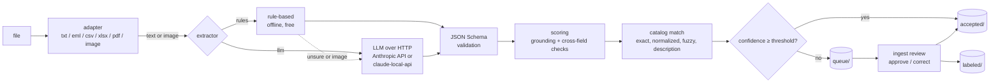

# llm-document-ingestion

Turn purchase orders and RFQs from manufacturing buyers (email, plain text,
chat exports, CSV, Excel, PDF, images) into schema-validated JSON. Match every
line to a part catalog, score how sure the system is, and send only the
uncertain documents to a person. Their corrections are saved as labeled data.

This is a small, clean-room reference implementation in Go with no
third-party modules. It mirrors the patterns of AI order-ingestion work that
Vishal Kumar led in industry. That work's production results (sales quotation
turnaround cut from 45 days to 5, and about 90% straight-through acceptance on
AI part matching) belong to that system, **not to this repository**. No
employer code, data or names are used here. Every company, part and document
in this repository is synthetic. The measured results of *this* code are in
[Results](#results).

## Problem

A manufacturer's sales desk receives requests for quotation and purchase
orders in every format a buyer can produce: a PDF exported from an ERP, an
Excel sheet with columns in whatever order, an email with a pasted table, or
a chat message that says "need 500 pcs HXB-M8-30 @ 0.13". Someone retypes each
one into the quoting system and works out which catalog part each line means.
That queue, not pricing, is what makes quotes slow.

The goal is not 100% automation. It is the **highest straight-through rate you
can get while holding the error rate among auto-accepted documents under a
ceiling you choose**. Everything below is built to measure and control that
trade-off.

## Design



| Stage | What it does | Code |
|---|---|---|
| Adapters | Text, email (`net/mail`, multipart, quoted-printable), CSV (comma or semicolon), XLSX read with `archive/zip` + `encoding/xml`, PDF text layer via `pdftotext -layout`. Images pass through as bytes. Tables become `a \| b \| c` rows, so one text parser and the LLM see the same thing. | `internal/adapters` |
| Rule-based extractor | Labelled header fields in many wordings, item tables in any column order (pipe-, tab- or space-aligned), units inside quantities, European decimal commas, chat-style lines (with low confidence). Cannot read images. | `internal/extract/rules.go` |
| LLM extractor | One Messages API call with the JSON Schema in the system prompt and the document wrapped as delimited data. It can also point at a [claude-local-api](https://github.com/the-vishal-kumar/claude-local-api) `/v1/run` endpoint. Timeouts, retries with jittered backoff and `Retry-After`, a response size cap. It logs only status, attempt and latency. | `internal/extract/llm.go` |
| Validation | Every extraction, rule-based included, must pass `po.schema.json` (`additionalProperties: false` everywhere). The validator supports a declared subset of keywords and refuses to compile a schema that uses anything else. | `internal/schema` |
| Scoring | Per-field confidence, then **grounding** (is each value actually in the source text?), line totals against the document total, date sanity, currency consistency, fractional counts of pieces, and instruction-like text. Document confidence is the **weakest required field**, multiplied by a penalty for each failed check. | `internal/score` |
| Catalog matching | Exact → normalized (case and punctuation) → fuzzy (edit distance with transpositions, plus a margin against the runner-up) → description token overlap. Then it cross-checks sizes in the description and the unit of measure against the chosen item. | `internal/catalog` |
| Routing and review | Auto-accept at or above the threshold (default 0.85). Otherwise the document goes to a JSON file queue with its reasons. `ingest review approve/correct` writes the final record and a label (prediction, correction, changed fields, reviewer). | `internal/pipeline`, `internal/review` |
| Eval | A seeded generator for documents and ground truth, per-field precision/recall/F1, straight-through rate, error rate among auto-accepted documents, a threshold sweep and the top reasons for review. | `internal/synth`, `internal/eval` |

## Trade-offs

**Why rules and an LLM, not one or the other.** On structured inputs (exports,
spreadsheets, templated emails) rules are free, deterministic and fast, and you
can test them. They fail on free text: on the synthetic set the rules
auto-accept 0% of chat messages. An LLM handles chats, images and unfamiliar
layouts, but it costs money per document, adds latency and can be wrong in
fluent ways. The `cascade` extractor runs the rules first and calls the LLM
only when the rules are unsure or cannot read the input. You pay for the hard
documents and nothing for the easy ones.

**Why confidence routing, and why the minimum.** One wrong quantity makes the
whole order wrong, so document confidence is the weakest field, not an
average. The threshold is a business decision, not a model property. Pick it
from the sweep in the results file: the lowest threshold whose error rate
among auto-accepted documents is under the ceiling you will accept.

**Model output is untrusted.** The model never supplies confidence (the schema
has no field for it) and it cannot influence routing. Output must be one JSON
object that passes the schema and decodes with unknown fields rejected. Its
values then have to appear in the source text, or their confidence drops to
30%. An LLM can only score well by copying what the document says.

**Cost per document.** These are estimates, not measurements. Assume a typical
PO of about 400 tokens, plus a fixed system prompt and schema of about 900
tokens, with 400 to 1,000 output tokens (JSON plus a little thinking at
`effort: low`). On `claude-sonnet-5-5` list prices ($2 / $10 per million
input/output tokens) that is roughly $0.005 to $0.013 per document, and an
image page adds roughly 1,500 input tokens. The cascade only spends that on
documents the rules send to review: about 31% of the held-out set, so about a
third of the LLM-only cost. The fixed system prompt makes prompt caching an
option at volume. `make eval-llm` reports the measured mean tokens per
document. Compare the result against minutes of a person's time, not against
zero.

**Failure modes and what catches them.**

| Failure | Defence |
|---|---|
| Hallucinated or "helpful" values | Grounding check against the source text; schema rejects extra fields |
| Prompt injection inside a document | Document sent as delimited data with closing tags neutralised; system prompt says to ignore embedded instructions; nothing the model returns can set routing; instruction-like text forces human review. Tested in `pipeline_test.go` with a fake model that *obeys* the injection |
| Truncated, refused or malformed reply | `stop_reason` checked; schema validation; the document goes to review with the reason (no blind re-ask) |
| Near-miss SKUs (`HXB-M8-20` vs `-30`) | Fuzzy margin against the runner-up; numbers in the description must match the chosen item |
| Ambiguous dates (`04/03/2026`) | Read day-first at 0.5 confidence, so the document goes to review |
| Locale numbers (`1.000`, `0,25`) | Decimal commas parsed; totals and "fractional pieces" checks. Residual: RFQs with no totals (see Results) |
| Wrong totals from the buyer | Line-total check fails and the document goes to review |
| API outage or rate limits | Retries with backoff, then review; rule-based ingestion keeps working |
| Scanned PDF, image without a vision model | Goes to review with an explicit reason |
| Leaking documents or keys | Logs carry ids, status and latency only; errors carry HTTP status and error type, never bodies |

**Dependencies.** The Go module has no third-party requirements: the JSON
Schema subset, the XLSX reader, the email parser and the HTTP client are all
built on the standard library. A general JSON Schema library would add a
supply chain for a schema that this repository owns and keeps small. The LLM
call is raw HTTP, not the Anthropic Go SDK. It is one endpoint, and the same
transport has to speak claude-local-api's `/v1/run`, which is not the Messages
API. In a larger codebase that already uses the SDK, use the SDK. The runtime
needs `pdftotext` from poppler-utils, called as a subprocess with a fixed
argv over stdin/stdout. CI fetches staticcheck and govulncheck at pinned
versions through `go run`, so they never enter `go.mod`.

**What the file queue is not.** It is a single-writer, inspectable store meant
for a reference implementation. Production needs a database, locking,
assignment and an audit trail.

## Results

Measured by running the code in this repository on synthetic data. Run
`make eval` to regenerate. Both files are committed, and CI fails if the code
no longer reproduces them byte for byte.

| Rule-based baseline, threshold 0.85 | Dev set (seed 42, 300 docs) | Held-out (seed 2026, 1,000 docs) |
|---|---:|---:|
| Straight-through rate | 67.7% | 68.8% |
| Error rate among auto-accepted | 0.0% (0/203) | 0.4% (3/688) |
| Documents fully correct, any route | 85.7% | 84.0% |
| Straight-through on chat messages | 0.0% | 0.0% |

Full tables (per-field precision/recall/F1, per format, threshold sweep,
reasons for review): [results/baseline.md](results/baseline.md) and
[results/baseline-heldout.md](results/baseline-heldout.md).

How to read these numbers:

- **They are optimistic for non-chat formats.** The generator and the rules
  share an author, so the rules know the generator's vocabulary. Real
  documents are messier. The numbers show that the routing machinery works
  (confidence separates right from wrong); they say little about accuracy on
  real buyer documents.
- **The three held-out errors are all the same case:** a European `1.000`
  (one thousand) read as 1, in an RFQ that has no prices or total to
  cross-check. The right fix is buyer locale from customer master data, not
  another regex. It is left visible because it shows what the error-rate
  metric is for.
- **Chat messages are where rules stop.** They never auto-accept, and that is
  the case for the cascade.
- The eval set has no images (the standard library has no text rasteriser).
  The image path is covered by unit tests only.

**LLM and cascade extractors:** not measured here, because this environment
has no API key. Run `make eval-llm` with an API key to produce
`results/llm.md` and `results/cascade.md`. Nothing in this repository reports
LLM accuracy until those files exist.

## How to run

With Docker only (no Go toolchain needed):

```bash
docker build -t llm-document-ingestion .
docker run --rm llm-document-ingestion eval -n 300 -seed 42          # prints the baseline report
docker run --rm -v "$PWD/examples:/data:ro" llm-document-ingestion run -dry-run /data/doc-0003.txt /data/prompt-injection.txt
make docker-ci                                                       # lint, test, vuln, eval-check in a container
```

With Go 1.27+ and `pdftotext` on the PATH:

```bash
make test            # table-driven tests, race detector
make lint vuln       # gofmt, go vet, staticcheck, govulncheck
make eval            # regenerate results/*.md
make demo            # ingest examples/ into ./var and list the review queue
```

Reviewing:

```bash
./bin/ingest review list
./bin/ingest review show <id>
./bin/ingest review approve <id> -reviewer pat
./bin/ingest review correct <id> -reviewer pat -set buyer="Harbor Valve Co" -set 'line_items[0].quantity=1000'
./bin/ingest review correct <id> -reviewer pat -file fixed.json      # must pass the schema
```

With an LLM:

```bash
export ANTHROPIC_API_KEY=...                  # never logged
export ANTHROPIC_MODEL=claude-sonnet-5-5      # default
export INGEST_LLM_EFFORT=low                  # default
./bin/ingest run -extractor cascade examples/doc-0005.txt   # chat message: rules unsure, LLM fallback

# Or a local claude-local-api endpoint (bills a Claude subscription, single user):
export INGEST_LLM_PROVIDER=local INGEST_LLM_BASE_URL=http://localhost:8787
```

HTTP:

```bash
./bin/ingest serve -addr 127.0.0.1:8080
curl -s --data-binary @examples/doc-0001.csv 'localhost:8080/v1/ingest?filename=doc-0001.csv'
```

Generate your own data: `./bin/ingest gen -n 50 -seed 1 -out /tmp/docs`
writes documents, `*.truth.json` files and `catalog.json`.

## Layout

```
cmd/ingest/          CLI: run, review, eval, gen, serve
internal/adapters/   file formats -> text or image bytes
internal/extract/    Extractor interface, rule-based and LLM implementations
internal/schema/     po.schema.json and the validator
internal/score/      field confidence, grounding and cross-field checks
internal/catalog/    tiered part matching
internal/pipeline/   orchestration and routing
internal/review/     file-backed queue and labeled data
internal/synth/      synthetic catalog, documents and ground truth
internal/eval/       metrics and the markdown report
examples/            12 generated documents with truth, plus a prompt-injection sample
results/             committed eval output
```

## Known gaps

- LLM and cascade accuracy are unmeasured until someone runs `make eval-llm`.
- No images in the eval set. Only the first XLSX sheet is read. Email
  attachments are ignored (only the text body is read). Table rows that wrap
  onto a second line go to review instead of being joined.
- The model is asked for JSON through the prompt and validated locally, which
  works with both endpoints. On the Anthropic API, structured outputs
  (`output_config.format`) would remove most malformed-output failures.
- Number locale is guessed per value, not known per buyer.
- The review store has no locking or authentication. The HTTP endpoint has no
  authentication either, so bind it to localhost.

## License

MIT © 2026 Vishal Kumar
